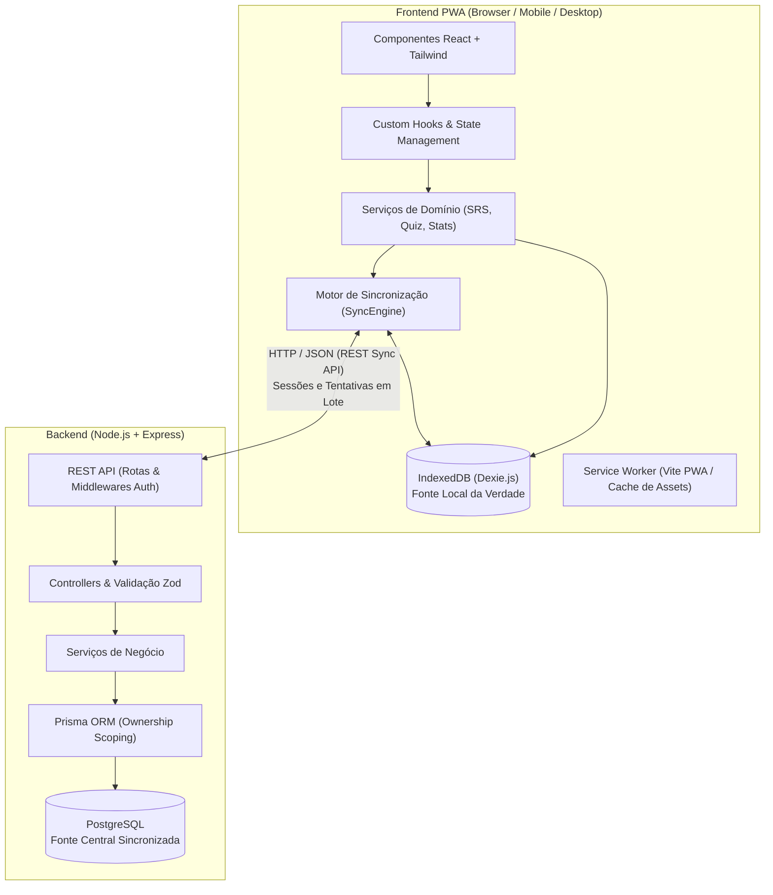

# Arquitetura do Bokken Estudos

Este documento detalha as decisões de engenharia, padrões arquiteturais, segurança de dados e a organização sistêmica do **Bokken Estudos**.

---

## 1. Visão Geral da Arquitetura

O Bokken Estudos adota uma arquitetura **Offline-First** orientada a eventos e persistência local como fonte primária de verdade (*Single Source of Truth*) no cliente.



### Princípios Norteadores:
1. **Zero Bloqueio por Rede:** O usuário pode abrir o aplicativo, navegar pelos Focos, configurar um quiz e responder perguntas sem nenhuma requisição de rede ativa.
2. **Idempotência Garantida:** Todo registro transacional (como tentativas de questões e sessões) nasce com UUID v4 no frontend. Reenvios nunca duplicam dados.
3. **Preservação Histórica Inegociável:** Respostas e tentativas nunca são apagadas por exclusões de conteúdo. O banco utiliza `onDelete: Restrict` e Soft Delete.
4. **Isolamento Multitenant Estrito:** O backend impõe escopo de propriedade em 100% das consultas do Prisma e na validação da árvore hierárquica.

---

## 2. Estrutura do Repositório (Monorepo)

O projeto é organizado no formato monorepo utilizando workspaces do `npm` ou `pnpm`, permitindo o compartilhamento seguro de contratos e tipos entre cliente e servidor sem duplicação de código.

```
bokken/
├── apps/
│   ├── frontend/                 # Aplicação React + Vite PWA
│   │   ├── public/               # Ícones, manifest.json, assets estáticos
│   │   ├── src/
│   │   │   ├── assets/           # Imagens, vetores SVG, estilos globais
│   │   │   ├── components/       # Componentes visuais
│   │   │   │   ├── common/       # Button, Card, Modal, Input, Badge
│   │   │   │   ├── flashcard/    # CardFlip3D, FrontSide, BackSide
│   │   │   │   ├── quiz/         # QuizRunner, QuestionNavigation, AnswerFeedback
│   │   │   │   ├── stats/        # ContributionCalendar, PerformanceChart
│   │   │   │   └── layout/       # Header, Sidebar, Container, SyncStatusPill
│   │   │   ├── context/          # AuthContext, SyncContext, ThemeContext
│   │   │   ├── db/               # Dexie.js (banco local)
│   │   │   │   ├── index.ts      # Instância do BokkenDexieDB
│   │   │   │   └── schema.ts     # Tabelas e índices do IndexedDB
│   │   │   ├── hooks/            # useQuiz, useSync, useOfflineStats, useCardFlip
│   │   │   ├── pages/            # Home, QuizPage, FocusManager, StatsPage, Login
│   │   │   ├── services/         # Lógica de domínio e comunicação
│   │   │   │   ├── api.ts        # Cliente HTTP (Axios ou Fetch wrapper)
│   │   │   │   ├── sync/         # SyncEngine, SyncQueue, NetworkStatus
│   │   │   │   ├── srs/          # Algoritmo de repetição espaçada no cliente
│   │   │   │   └── stats/        # Agregação de estatísticas offline
│   │   │   ├── styles/           # Tailwind CSS e animações customizadas 3D
│   │   │   ├── App.tsx
│   │   │   └── main.tsx
│   │   ├── index.html
│   │   ├── vite.config.ts
│   │   ├── tailwind.config.js
│   │   └── package.json
│   │
│   └── backend/                  # API REST Node.js + Express
│       ├── prisma/
│       │   ├── schema.prisma     # Modelagem de dados PostgreSQL
│       │   ├── migrations/       # Histórico de migrações do banco
│       │   └── seed.ts           # Carga inicial para desenvolvimento
│       ├── src/
│       │   ├── config/           # Variáveis de ambiente, constantes
│       │   ├── controllers/      # AuthController, FocusController, QuestionController, SyncController
│       │   ├── middlewares/      # authMiddleware, validateRequest, errorHandler, rateLimiter
│       │   ├── repositories/     # Camada de abstração Prisma (PrismaUserRepository, etc.)
│       │   ├── routes/           # Rotas Express modularizadas
│       │   ├── services/         # Regras de negócio (AuthService, SyncService, StatsService)
│       │   ├── utils/            # Hash (bcrypt), tokens (jwt), formatters
│       │   └── server.ts         # Inicialização do Express
│       ├── tsconfig.json
│       └── package.json
│
├── packages/
│   └── shared/                   # Código e tipos compartilhados
│       ├── src/
│       │   ├── types/            # DTOs, Enums, Interfaces de domínio
│       │   ├── schemas/          # Schemas de validação Zod compartilhados
│       │   └── constants/        # Configurações globais (regras de repetição, tempos)
│       ├── tsconfig.json
│       └── package.json
│
├── docs/                         # Documentação técnica e planejamento
│   ├── ARCHITECTURE.md
│   ├── DATABASE_SCHEMA.md
│   ├── SYNC_STRATEGY.md
│   └── ROADMAP.md
├── package.json                  # Root package.json (workspaces)
└── README.md
```

---

## 3. Segurança e Propriedade dos Dados (Multitenancy Seguro)

Para prevenir vulnerabilidades do tipo **BOLA/IDOR (Broken Object Level Authorization)**, o backend implementa quatro camadas de isolamento rigoroso:

### 3.1. Autenticação e Extração Segura de Identidade
- Toda requisição privada exige o header `Authorization: Bearer <JWT>`.
- O `authMiddleware` valida criptograficamente a assinatura e injeta `req.user = { id: string, email: string }`.
- O `userId` proveniente do payload HTTP (JSON do body ou query params) é **completamente ignorado** para fins de segurança; apenas o identificador autenticado `req.user.id` é utilizado na persistência.

### 3.2. Scoping Obrigatório em Consultas do Prisma
Nenhuma consulta de busca, atualização ou exclusão de entidades do usuário pode ser realizada unicamente por `id`. O escopo de posse deve ser explicitamente aplicado:

```typescript
// Exemplo Seguro no FocusService:
const focus = await prisma.focus.findFirst({
  where: {
    id: focusId,
    userId: req.user.id, // Escopo de posse direto
    deletedAt: null
  }
});

// Exemplo Seguro no QuestionService:
const question = await prisma.question.findFirst({
  where: {
    id: questionId,
    subject: {
      focus: {
        userId: req.user.id // Escopo de posse pela hierarquia
      }
    },
    deletedAt: null
  }
});
```

### 3.3. Validação Hierárquica na Criação de Conteúdos
Ao criar um elemento filho (ex: Pergunta vinculada a uma Matéria), o backend valida antes da inserção se a entidade pai realmente pertence ao usuário autenticado:
1. `POST /api/subjects`: valida se `focusId` pertence a `req.user.id`.
2. `POST /api/questions`: valida se `subjectId` pertence a um Foco de `req.user.id`.
Se a validação falhar, a API retorna `404 Not Found` (em vez de `403 Forbidden`) para não confirmar a existência de identificadores alheios a atacantes.

### 3.4. Blindagem no Motor de Sincronização (`SyncPush`)
No endpoint `POST /api/sync/push`:
- O payload traz uma lista de tentativas com `questionId`.
- O backend consulta o banco verificando se todas as `questionId`s enviadas pertencem à árvore de Focos do usuário autenticado.
- Tentativas com `questionId` inválida ou de outro usuário são imediatamente descartadas com log de segurança.
- O campo `userId` inserido em `QuestionAttempt` e `QuizSession` é injetado pelo servidor a partir de `req.user.id`.
