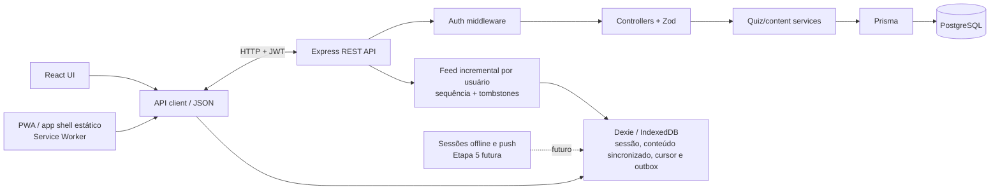

# Arquitetura do Bokken Estudos

Este documento descreve a arquitetura implementada e identifica claramente as partes ainda planejadas. O quiz e o envio de respostas continuam online-first. Dexie v2 mantém a tabela `session` ativa usada pelo `AuthContext` e stores isoladas por usuário para conteúdo, manifestos, cursor e outbox. A subetapa 5.2 disponibiliza o app shell estático; a 5.3 implementa o pull incremental de conteúdo e sua persistência local. Sessões offline e push da outbox permanecem planejados.

---

## 1. Visão Geral da Arquitetura

O Bokken Estudos é um monorepo React/Express. Na Etapa 4, o PostgreSQL é a autoridade para sessões, manifestos e tentativas; o cliente envia somente a resposta e uma chave de idempotência. O app shell pode ser recarregado offline depois de instalado; conteúdo, quizzes e operações continuam online. O JWT guardado localmente em IndexedDB não é criptografado e continua acessível ao JavaScript da origem; não deve ser tratado como mecanismo seguro contra XSS.



### Princípios Norteadores:
1. **Autoridade no servidor:** sessão, manifesto e snapshot são criados pelo backend; a identidade vem do JWT.
2. **Idempotência de resposta:** cada tentativa tem chave UUID de idempotência por usuário, garantida por índice único.
3. **Preservação histórica:** snapshots carregam enunciado, justificativa, resposta esperada e todas as alternativas apresentadas.
4. **Isolamento multitenant:** consultas de quiz são limitadas ao usuário autenticado e a seus conteúdos ativos.

---

## 2. Estrutura do Repositório (Monorepo)

O projeto é organizado no formato monorepo utilizando workspaces do `npm` ou `pnpm`, permitindo o compartilhamento seguro de contratos e tipos entre cliente e servidor sem duplicação de código.

> A árvore abaixo é uma visão lógica do destino do monorepo e inclui diretórios planejados; confira a árvore do repositório para os arquivos realmente existentes.

```
bokken/
├── apps/
│   ├── frontend/                 # Aplicação React + Vite SPA com app shell PWA
│   │   ├── public/               # Manifest, favicon e ícones PWA
│   │   ├── src/
│   │   │   ├── assets/           # Imagens, vetores SVG, estilos globais
│   │   │   ├── components/       # Componentes visuais
│   │   │   │   ├── common/       # Button, Card, Modal, Input, Badge
│   │   │   │   ├── flashcard/    # CardFlip3D, FrontSide, BackSide
│   │   │   │   ├── quiz/         # QuizRunner, QuestionNavigation, AnswerFeedback
│   │   │   │   ├── stats/        # ContributionCalendar, PerformanceChart
│   │   │   │   └── layout/       # Header, Sidebar, Container, SyncStatusPill
│   │   │   ├── context/          # AuthContext, SyncContext, ThemeContext
│   │   │   ├── db/               # Dexie.js; atualmente somente sessão ativa
│   │   │   │   └── index.ts      # Store session (perfil/JWT); cache e outbox planejados
│   │   │   ├── hooks/            # useQuiz, useSync, useOfflineStats, useCardFlip
│   │   │   ├── pages/            # Home, QuizPage, FocusManager, StatsPage, Login
│   │   │   ├── services/         # Lógica de domínio e comunicação
│   │   │   │   ├── api.ts        # Cliente HTTP (Axios ou Fetch wrapper)
│   │   │   │   ├── sync/         # SyncEngine, SyncQueue, NetworkStatus
│   │   │   │   ├── srs/          # Algoritmo de repetição espaçada no cliente
│   │   │   │   └── stats/        # Agregação de estatísticas offline
│   │   │   ├── styles/           # Tailwind CSS e animações customizadas 3D
│   │   │   ├── App.tsx
│   │   │   └── main.tsx
│   │   ├── index.html
│   │   ├── vite.config.ts
│   │   ├── tailwind.config.js
│   │   └── package.json
│   │
│   └── backend/                  # API REST Node.js + Express
│       ├── prisma/
│       │   ├── schema.prisma     # Modelagem de dados PostgreSQL
│       │   ├── migrations/       # Histórico de migrações do banco
│       │   └── seed.ts           # Carga inicial para desenvolvimento
│       ├── src/
│       │   ├── config/           # Variáveis de ambiente, constantes
│       │   ├── controllers/      # AuthController, FocusController, QuestionController, SyncController
│       │   ├── middlewares/      # authMiddleware, validateRequest, errorHandler, rateLimiter
│       │   ├── repositories/     # Camada de abstração Prisma (PrismaUserRepository, etc.)
│       │   ├── routes/           # Rotas Express modularizadas
│       │   ├── services/         # Regras de negócio (AuthService, SyncService, StatsService)
│       │   ├── utils/            # Hash (bcrypt), tokens (jwt), formatters
│       │   └── server.ts         # Inicialização do Express
│       ├── tsconfig.json
│       └── package.json
│
├── packages/
│   └── shared/                   # Código e tipos compartilhados
│       ├── src/
│       │   ├── types/            # DTOs, Enums, Interfaces de domínio
│       │   ├── schemas/          # Schemas de validação Zod compartilhados
│       │   └── constants/        # Configurações globais (regras de repetição, tempos)
│       ├── tsconfig.json
│       └── package.json
│
├── docs/                         # Documentação técnica e planejamento
│   ├── ARCHITECTURE.md
│   ├── DATABASE_SCHEMA.md
│   ├── SYNC_STRATEGY.md
│   └── ROADMAP.md
├── package.json                  # Root package.json (workspaces)
└── README.md
```

### App shell PWA (subetapa 5.2)

- `apps/frontend/public/manifest.webmanifest` e os ícones locais definem a instalação da aplicação.
- O Service Worker gerado pelo Vite precacheia somente HTML, bundles estáticos, manifest, favicon e ícones. A navegação tenta a rede e usa `/index.html` em caso de falha para suportar rotas da SPA.
- A estratégia não grava respostas de runtime: ignora caminhos `/api/`, requisições com `Authorization` e recursos que não fazem parte da lista explícita do precache. Não há cache de JWT, credenciais ou dados privados.
- Uma nova versão recebe um nome de cache derivado do conteúdo. O cache antigo só é removido na ativação; a UI oferece atualização explícita e recarrega após a troca do controller.
- O registro ocorre somente em build de produção. O modo de desenvolvimento não registra Service Worker.
- A primeira visita requer rede. Estar offline permite abrir a interface, mas ainda não disponibiliza conteúdo sincronizado, autenticação ou quizzes offline.

---

## 3. Segurança e Propriedade dos Dados (Multitenancy Seguro)

Para prevenir vulnerabilidades do tipo **BOLA/IDOR (Broken Object Level Authorization)**, o backend implementa quatro camadas de isolamento rigoroso:

### 3.1. Autenticação e Extração Segura de Identidade
- Toda requisição privada exige o header `Authorization: Bearer <JWT>`.
- O `authMiddleware` valida criptograficamente a assinatura e injeta `req.user = { id: string, email: string }`.
- O `userId` proveniente do payload HTTP (JSON do body ou query params) é **completamente ignorado** para fins de segurança; apenas o identificador autenticado `req.user.id` é utilizado na persistência.

### 3.2. Scoping Obrigatório em Consultas do Prisma
Nenhuma consulta de busca, atualização ou exclusão de entidades do usuário pode ser realizada unicamente por `id`. O escopo de posse deve ser explicitamente aplicado:

```typescript
// Exemplo Seguro no FocusService:
const focus = await prisma.focus.findFirst({
  where: {
    id: focusId,
    userId: req.user.id, // Escopo de posse direto
    deletedAt: null
  }
});

// Exemplo Seguro no QuestionService:
const question = await prisma.question.findFirst({
  where: {
    id: questionId,
    subject: {
      focus: {
        userId: req.user.id // Escopo de posse pela hierarquia
      }
    },
    deletedAt: null
  }
});
```

### 3.3. Validação Hierárquica na Criação de Conteúdos
Ao criar um elemento filho (ex: Pergunta vinculada a uma Matéria), o backend valida antes da inserção se a entidade pai realmente pertence ao usuário autenticado:
1. `POST /api/subjects`: valida se `focusId` pertence a `req.user.id`.
2. `POST /api/questions`: valida se `subjectId` pertence a um Foco de `req.user.id`.
Se a validação falhar, a API retorna `404 Not Found` (em vez de `403 Forbidden`) para não confirmar a existência de identificadores alheios a atacantes.

### 3.4. Contrato de quiz online atual
- `POST /api/quizzes/sessions` seleciona perguntas ativas de conteúdo pertencente ao usuário autenticado e grava snapshot completo + posição no manifesto.
- `GET` e as rotas de resposta consultam a sessão dentro do escopo do proprietário. O cliente não fornece `userId`.
- Para responder, a API carrega o snapshot armazenado, valida o tipo e verifica que a alternativa enviada faz parte dele. `isCorrect` é calculado no servidor.
- A resposta discursiva recebe uma autoavaliação enumerada; o servidor deriva `isCorrect` dela. Chaves UUID idempotentes têm unicidade por usuário.
- `clientStudyDate` e `clientTimezone` são derivados pelo servidor do relógio de gravação e do fuso cadastrado no usuário; não vêm no payload.
- Snapshots pendentes não revelam alternativa correta, justificativa ou resposta esperada; esse conteúdo aparece depois do registro da resposta.

### 3.5. Pull incremental de conteúdo (Etapa 5.3)
- `GET /api/sync/content?cursor&limit` exige autenticação e deriva a conta exclusivamente do JWT.
- Cada mudança de foco, matéria ou pergunta e seu evento no feed são gravados na mesma transação. Uma linha de estado serializa sequências por usuário; tombstones de exclusões em cascata são emitidos em ordem de dependência.
- O cursor opaco usa AES-256-GCM, é ligado ao `userId` e conserva um watermark durante as páginas. Alterações confirmadas depois do watermark são entregues na rodada seguinte.
- DTOs de sync são separados dos DTOs do CRUD; alternativas contêm ID, texto e ordem, sem `isCorrect`; justificativas e respostas esperadas não são enviadas.
- O frontend aplica cada página e cursor atomicamente no Dexie, com chaves por usuário, validação de sessão ativa e rejeição de página que parta de cursor obsoleto. A outbox não é lida nem alterada.
- O endpoint está disponível para uso pela aplicação, mas a UI ainda não inicia o pull automaticamente. Sessões offline continuam indisponíveis.

### 3.6. Push e estudo offline futuros
Não existe endpoint `POST /api/sync/push` nesta etapa. O manifesto original do servidor deverá ser usado para validar respostas offline; idempotência de pulo, tickets por sessão/questão e resolução de replay serão definidos antes da implementação.
