# Modelo Relacional do PostgreSQL (Prisma ORM)

Este documento especifica a modelagem do banco de dados relacional PostgreSQL do **Bokken Estudos**, as regras de integridade e os índices estratégicos para suportar consultas analíticas, sincronização resiliente e preservação absoluta do histórico.

---

## 1. Diagrama Entidade-Relacionamento (ERD)

```mermaid
erDiagram
    User ||--o{ Focus : "possui"
    User ||--o{ QuizSession : "executa"
    User ||--o{ QuestionAttempt : "realiza (histórico)"
    User ||--o{ QuestionSRSProgress : "acumula"
    User ||--o{ DailyStudyLog : "registra"

    Focus ||--o{ Subject : "contém"
    Subject ||--o{ Question : "contém"
    Question ||--o{ QuestionOption : "possui (se múltipla escolha)"
    Question ||--o{ QuestionAttempt : "alvo de (onDelete: Restrict)"
    Question ||--o{ QuestionSRSProgress : "estado SRS"
    QuizSession ||--o{ QuestionAttempt : "agrupa (opcional)"

    User {
        uuid id PK
        string email UK
        string passwordHash
        string name
        string timezone "Ex: America/Sao_Paulo"
        datetime createdAt
        datetime updatedAt
    }

    Focus {
        uuid id PK
        uuid userId FK
        string name
        string description
        string color
        datetime createdAt
        datetime updatedAt
        datetime deletedAt "Soft delete"
    }

    Subject {
        uuid id PK
        uuid focusId FK
        string name
        string description
        datetime createdAt
        datetime updatedAt
        datetime deletedAt "Soft delete"
    }

    Question {
        uuid id PK
        uuid subjectId FK
        enum type "MULTIPLE_CHOICE | DISCURSIVE"
        text statement
        text explanation
        text expectedAnswer
        datetime createdAt
        datetime updatedAt
        datetime deletedAt "Soft delete"
    }

    QuestionOption {
        uuid id PK
        uuid questionId FK
        text text
        boolean isCorrect
        int orderIndex
        datetime retiredAt "Versão arquivada; alternativas históricas permanecem referenciáveis"
        datetime createdAt
        datetime updatedAt
    }

    QuestionSRSProgress {
        uuid id PK
        uuid userId FK
        uuid questionId FK
        int repetitions
        int consecutiveCorrect
        int totalAttempts
        int totalCorrect
        int totalIncorrect
        float priorityScore
        datetime lastAttemptAt
        datetime nextReviewAt
        datetime updatedAt
    }

    QuizSession {
        uuid id PK "UUID gerado no cliente"
        uuid userId FK
        enum mode "SUBJECT | FOCUS | GENERAL_ALL | GENERAL_CUSTOM"
        int totalQuestions
        int totalCorrect
        int totalIncorrect
        int durationSeconds
        datetime startedAt
        datetime finishedAt
        datetime createdAt
        datetime updatedAt
    }

    QuestionAttempt {
        uuid id PK "UUID gerado no cliente"
        uuid userId FK
        uuid questionId FK "onDelete: Restrict"
        uuid quizSessionId FK "onDelete: SetNull"
        boolean isCorrect
        uuid selectedOptionId FK "onDelete: SetNull"
        enum discursiveAssessment "CORRECT | INCORRECT"
        int timeSpentSeconds
        string clientStudyDate "YYYY-MM-DD no fuso do aluno"
        string clientTimezone "Timezone do dispositivo"
        json questionSnapshot "Enunciado, tipo, justificativa, gabarito e todas as alternativas apresentadas"
        datetime clientCreatedAt "Timestamp ISO UTC do dispositivo"
        datetime syncedAt "Timestamp de gravação no servidor"
    }

    DailyStudyLog {
        uuid id PK
        uuid userId FK
        date studyDate UK "YYYY-MM-DD por usuário"
        int questionsAnswered
        int correctCount
        int incorrectCount
        datetime updatedAt
    }
```



---

## 2. Código do Esquema Prisma (`prisma/schema.prisma`)

```prisma
datasource db {
  provider = "postgresql"
  url      = env("DATABASE_URL")
}

generator client {
  provider = "prisma-client-js"
}

enum QuestionType {
  MULTIPLE_CHOICE
  DISCURSIVE
}

enum DiscursiveAssessment {
  CORRECT
  INCORRECT
}

enum QuizMode {
  SUBJECT
  FOCUS
  GENERAL_ALL
  GENERAL_CUSTOM
}

model User {
  id           String   @id @default(uuid()) @db.Uuid
  email        String   @unique
  passwordHash String
  name         String
  timezone     String   @default("America/Sao_Paulo")
  createdAt    DateTime @default(now())
  updatedAt    DateTime @updatedAt

  foci             Focus[]
  quizSessions     QuizSession[]
  questionAttempts QuestionAttempt[]
  srsProgresses    QuestionSRSProgress[]
  dailyStudyLogs   DailyStudyLog[]

  @@map("users")
}

model Focus {
  id          String    @id @default(uuid()) @db.Uuid
  userId      String    @db.Uuid
  name        String
  description String?
  color       String?   @default("#1e3a8a")
  createdAt   DateTime  @default(now())
  updatedAt   DateTime  @updatedAt
  deletedAt   DateTime?

  user     User      @relation(fields: [userId], references: [id], onDelete: Cascade)
  subjects Subject[]

  @@index([userId, deletedAt])
  @@index([userId, updatedAt])
  @@map("foci")
}

model Subject {
  id          String    @id @default(uuid()) @db.Uuid
  focusId     String    @db.Uuid
  name        String
  description String?
  createdAt   DateTime  @default(now())
  updatedAt   DateTime  @updatedAt
  deletedAt   DateTime?

  focus     Focus      @relation(fields: [focusId], references: [id], onDelete: Restrict)
  questions Question[]

  @@index([focusId, deletedAt])
  @@index([focusId, updatedAt])
  @@map("subjects")
}

model Question {
  id             String       @id @default(uuid()) @db.Uuid
  subjectId      String       @db.Uuid
  type           QuestionType
  statement      String       @db.Text
  explanation    String?      @db.Text
  expectedAnswer String?      @db.Text
  createdAt      DateTime     @default(now())
  updatedAt      DateTime     @updatedAt
  deletedAt      DateTime?

  subject       Subject               @relation(fields: [subjectId], references: [id], onDelete: Restrict)
  options       QuestionOption[]
  attempts      QuestionAttempt[]
  srsProgresses QuestionSRSProgress[]

  @@index([subjectId, deletedAt])
  @@index([subjectId, updatedAt])
  @@map("questions")
}

model QuestionOption {
  id         String   @id @default(uuid()) @db.Uuid
  questionId String   @db.Uuid
  text       String   @db.Text
  isCorrect  Boolean  @default(false)
  orderIndex Int      @default(0)
  createdAt  DateTime @default(now())
  updatedAt  DateTime @updatedAt
  retiredAt  DateTime?

  question Question          @relation(fields: [questionId], references: [id], onDelete: Cascade)
  attempts QuestionAttempt[]

  @@index([questionId])
  @@map("question_options")
}

model QuestionSRSProgress {
  id                 String    @id @default(uuid()) @db.Uuid
  userId             String    @db.Uuid
  questionId         String    @db.Uuid
  repetitions        Int       @default(0)
  consecutiveCorrect Int       @default(0)
  totalAttempts      Int       @default(0)
  totalCorrect       Int       @default(0)
  totalIncorrect     Int       @default(0)
  priorityScore      Float     @default(1.0)
  lastAttemptAt      DateTime?
  nextReviewAt       DateTime?
  updatedAt          DateTime  @updatedAt

  user     User     @relation(fields: [userId], references: [id], onDelete: Cascade)
  question Question @relation(fields: [questionId], references: [id], onDelete: Restrict)

  @@unique([userId, questionId])
  @@index([userId, nextReviewAt])
  @@index([userId, priorityScore])
  @@map("question_srs_progress")
}

model QuizSession {
  id               String            @id @default(uuid()) @db.Uuid
  userId           String            @db.Uuid
  mode             QuizMode
  totalQuestions   Int               @default(0)
  totalCorrect     Int               @default(0)
  totalIncorrect   Int               @default(0)
  durationSeconds  Int               @default(0)
  startedAt        DateTime          @default(now())
  finishedAt       DateTime?
  createdAt        DateTime          @default(now())
  updatedAt        DateTime          @updatedAt

  user     User              @relation(fields: [userId], references: [id], onDelete: Cascade)
  attempts QuestionAttempt[]

  @@index([userId, startedAt])
  @@map("quiz_sessions")
}

model QuestionAttempt {
  id                   String                @id @default(uuid()) @db.Uuid
  userId               String                @db.Uuid
  questionId           String                @db.Uuid
  quizSessionId        String?               @db.Uuid
  isCorrect            Boolean
  selectedOptionId     String?               @db.Uuid
  discursiveAssessment DiscursiveAssessment?
  timeSpentSeconds     Int                   @default(0)
  clientStudyDate      String                @db.VarChar(10) // "YYYY-MM-DD" no fuso civil do aluno
  clientTimezone       String?               @db.VarChar(50) // "America/Sao_Paulo"
  statementSnapshot    String?               @db.Text
  selectedOptionTextSnapshot String?         @db.Text
  expectedAnswerSnapshot String?             @db.Text
  questionSnapshot     Json?                  @db.JsonB
  clientCreatedAt      DateTime
  syncedAt             DateTime              @default(now())

  user           User            @relation(fields: [userId], references: [id], onDelete: Cascade)
  question       Question        @relation(fields: [questionId], references: [id], onDelete: Restrict)
  quizSession    QuizSession?    @relation(fields: [quizSessionId], references: [id], onDelete: SetNull)
  selectedOption QuestionOption? @relation(fields: [selectedOptionId], references: [id], onDelete: SetNull)

  @@index([userId, clientCreatedAt])
  @@index([userId, clientStudyDate])
  @@index([questionId])
  @@index([quizSessionId])
  @@map("question_attempts")
}

model DailyStudyLog {
  id                String   @id @default(uuid()) @db.Uuid
  userId            String   @db.Uuid
  studyDate         DateTime @db.Date
  questionsAnswered Int      @default(0)
  correctCount      Int      @default(0)
  incorrectCount    Int      @default(0)
  updatedAt         DateTime @updatedAt

  user User @relation(fields: [userId], references: [id], onDelete: Cascade)

  @@unique([userId, studyDate])
  @@index([userId, studyDate])
  @@map("daily_study_logs")
}
```

---

## 3. Decisões Arquiteturais e Justificativas de Modelagem

### 3.1. Preservação Absoluta do Histórico (`onDelete: Restrict`)
- **O Problema do Cascade:** Em sistemas de estudo, um erro clássico é definir `onDelete: Cascade` entre a Pergunta e a Tentativa. Se uma matéria ou foco for excluído, ou se uma pergunta for purgada acidentalmente, todo o histórico de resolução do estudante (tentativas, tempos e métricas) seria apagado.
- **A Solução:**
  - `QuestionAttempt.question` possui **`onDelete: Restrict`**. O motor relacional do PostgreSQL rejeitará categoricamente qualquer tentativa de exclusão física de perguntas que já possuam tentativas vinculadas.
  - O mesmo se aplica a `Question.subject` e `Subject.focus`, que utilizam `onDelete: Restrict`.
  - A exclusão de conteúdos é **100% lógica (Soft Delete via `deletedAt`)**. Ao excluir um Foco, Matéria ou Pergunta, apenas o campo `deletedAt` é preenchido.
  - As perguntas excluídas logicamente são excluídas das consultas de novos quizzes (`WHERE deletedAt IS NULL`), mas permanecem no banco para alimentar relatórios históricos, gráficos de aproveitamento acumulado e auditoria.
  - Cada tentativa futura deve carregar `questionSnapshot`, contendo tipo, enunciado, justificativa, resposta esperada e **todas** as alternativas apresentadas (texto, ordem e indicação da correta). O snapshot é capturado no cliente ao responder, inclusive em modo offline.
  - Ao editar alternativas, as linhas antigas recebem `retiredAt`; seus IDs e relações com tentativas permanecem intactos. A migração `20261106010000_preserve_question_attempt_context` apenas adiciona colunas anuláveis. Tentativas antigas não recebem snapshots fabricados porque não há como reconstruir com segurança versões anteriores do conteúdo.
  - O único `onDelete: Cascade` permitido é no nível do `User`: se o estudante solicitar a exclusão de sua conta integral (em conformidade com a LGPD), todos os seus dados pessoais são purgados em cascata.

### 3.2. Fuso Horário e Integridade de Ofensiva (`clientStudyDate` e `User.timezone`)
- **O Problema:** Respostas dadas às 23:40 no horário de Brasília (`America/Sao_Paulo`, UTC-3) correspondem a 02:40 do dia seguinte em UTC. Se o servidor calcular o calendário diário usando a data UTC, a ofensiva do dia será quebrada e o mapa de contribuição marcará o dia incorreto.
- **A Solução:**
  - O perfil do usuário armazena `timezone` (ex: `"America/Sao_Paulo"`), detectado no frontend via `Intl.DateTimeFormat().resolvedOptions().timeZone`.
  - A tentativa registra `clientCreatedAt` (timestamp UTC preciso) e **`clientStudyDate`** (string no formato `YYYY-MM-DD` representando o dia civil local do aluno quando a resposta foi submetida).
  - O `DailyStudyLog` utiliza `@db.Date`, consolidando o dia civil real de estudo sem distorções de fuso.

### 3.3. Identificadores de Sessões Offline (`QuizSession`)
- **Geração Descentralizada:** Sessões criadas no cliente recebem um UUID v4 via `crypto.randomUUID()`.
- **Relacionamento Seguro:** `QuestionAttempt.quizSessionId` possui `onDelete: SetNull`. Se uma sessão for cancelada ou descartada, as tentativas individuais de resposta continuam salvas no histórico do estudante.
