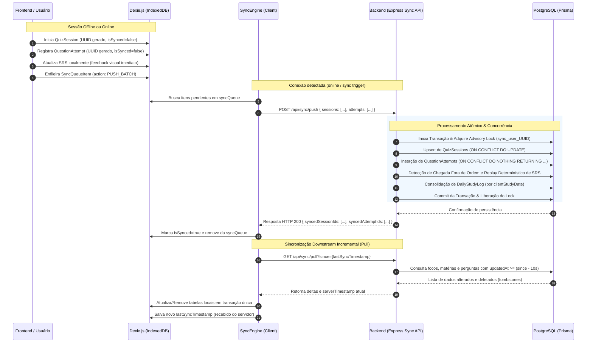

# Estratégia de Sincronização: IndexedDB & PostgreSQL

> **Estado:** este documento descreve a futura Etapa 5, não funcionalidades disponíveis agora. Sessões e tentativas online da Etapa 4 são criadas pelo servidor (`POST /api/quizzes/sessions` e rotas filhas), que mantém um manifesto `QuizSessionQuestion` com `questionSnapshot`. O cliente não envia `userId`, snapshot ou resultado correto. Sincronização, Dexie como persistência local e PWA ainda não foram implementados. Para ingestão offline, manifestos/tickets devem ser emitidos pelo servidor; uma assinatura feita com chave armazenada no navegador não autentica resultados contra um cliente comprometido.

Este documento registra uma proposta de sincronização **futura** do Bokken Estudos. Os exemplos de Dexie, fila e endpoints de sync são conceituais e não devem ser interpretados como implementação presente.

---

## 1. Topologia do Armazenamento Local (IndexedDB via Dexie.js)

O banco de dados local do cliente (`BokkenDexieDB`) replica os modelos necessários para o estudo offline e introduz tabelas de controle de sincronização:

```typescript
export class BokkenDexieDB extends Dexie {
  foci!: Table<LocalFocus, string>;
  subjects!: Table<LocalSubject, string>;
  questions!: Table<LocalQuestion, string>;
  questionOptions!: Table<LocalQuestionOption, string>;
  questionSRSProgress!: Table<LocalSRSProgress, string>;
  quizSessions!: Table<LocalQuizSession, string>;
  questionAttempts!: Table<LocalQuestionAttempt, string>;
  dailyStudyLogs!: Table<LocalDailyStudyLog, string>;
  syncQueue!: Table<SyncQueueItem, string>;
  syncMeta!: Table<SyncMeta, string>;

  constructor() {
    super('BokkenLocalDB');
    this.version(1).stores({
      foci: 'id, userId, updatedAt, deletedAt',
      subjects: 'id, focusId, updatedAt, deletedAt',
      questions: 'id, subjectId, type, updatedAt, deletedAt',
      questionOptions: 'id, questionId, isCorrect',
      questionSRSProgress: 'id, [userId+questionId], priorityScore, nextReviewAt',
      quizSessions: 'id, userId, startedAt, isSynced',
      questionAttempts: 'id, userId, questionId, quizSessionId, clientCreatedAt, clientStudyDate, isSynced',
      dailyStudyLogs: 'id, [userId+studyDate]',
      syncQueue: 'id, action, createdAt, status, retryCount',
      syncMeta: 'key, lastSyncTimestamp'
    });
  }
}
```

---

## 2. Fluxo Bidirecional de Sincronização

A sincronização é composta por duas vias independentes: **Upstream** (Envio de tentativas e sessões locais pendentes) e **Downstream** (Atualização incremental de conteúdos do servidor).



---

## 3. Resolução Técnica dos Desafios Críticos

### 3.1. Processamento de Tentativas Fora de Ordem (Out-of-Order) e Replay de SRS
- **O Cenário:**
  - O estudante responde à pergunta $Q_1$ no celular offline na Segunda-feira (Tentativa $T_1$, `clientCreatedAt` = Segunda).
  - Na Terça-feira, estuda no computador online e responde à mesma pergunta $Q_1$ (Tentativa $T_2$, `clientCreatedAt` = Terça).
  - Na Quarta-feira, o celular reconecta e envia a tentativa de Segunda ($T_1$).
  - Se o backend simplesmente fizesse incrementos (`repetitions = repetitions + 1`), a tentativa de Segunda seria processada como se tivesse ocorrido na Quarta, distorcendo os intervalos de repetição e o fator de prioridade da questão.
- **A Solução (Replay Determinístico):**
  1. A inserção em lote utiliza:
     ```sql
     INSERT INTO question_attempts (id, user_id, question_id, quiz_session_id, is_correct, client_study_date, client_created_at, synced_at)
     VALUES ($1, $2, $3, $4, $5, $6, $7, NOW())
     ON CONFLICT (id) DO NOTHING
     RETURNING id, question_id, client_created_at, is_correct;
     ```
  2. O backend identifica os IDs das tentativas que foram **efetivamente inseridas pela primeira vez** (filtrando reenvios).
  3. Para cada `questionId` afetado:
     - O backend verifica se o menor `clientCreatedAt` das novas tentativas é anterior ao `lastAttemptAt` registrado no `QuestionSRSProgress`.
     - Caso seja detectada chegada retroativa (fora de ordem), o backend recalcula o estado da questão executando uma função pura de replay sobre o histórico cronológico completo:
       ```sql
       SELECT is_correct, client_created_at, time_spent_seconds 
       FROM question_attempts 
       WHERE user_id = $1 AND question_id = $2 
       ORDER BY client_created_at ASC;
       ```
     - A função pura `calculateSRSState(history)` no `packages/shared` gera o estado matematicamente exato de intervalos, número de acertos consecutivos e prioridade, eliminando qualquer inconsistência temporal.

### 3.2. Tratamento de Reenvios e Sincronizações Simultâneas (Concorrência)
- **O Risco:**
  - Se a rede oscilar, o cliente pode disparar múltiplos retries em paralelo, ou dois navegadores/dispositivos do mesmo usuário podem sincronizar no mesmo segundo, causando condições de corrida (*race conditions*) ou *deadlocks* no banco.
- **A Solução:**
  1. **Idempotência por Chave Primária:** Tentativas e sessões possuem UUIDv4 gerados no cliente. Múltiplos envios da mesma tentativa são descartados pelo banco sem erro (`ON CONFLICT (id) DO NOTHING`).
  2. **PostgreSQL Transaction Advisory Locks:**
     - No início da transação de sincronização, o backend executa:
       ```sql
       SELECT pg_advisory_xact_lock(hashtext('sync_user_' || $userId));
       ```
     - Esse lock é específico para o usuário autenticado e dura apenas enquanto a transação de banco estiver aberta.
     - Se duas requisições de sync do mesmo usuário chegarem ao mesmo tempo, a segunda aguarda ordenadamente a finalização da primeira. Quando a segunda executa, os registros já foram inseridos, garantindo integridade absoluta sem necessidade de filas externas como Redis.

### 3.3. Sincronização Incremental Confiável (Anti-Loss & Safety Overlap)
- **A Falha Clássica do `lastSyncTimestamp` (The Long Transaction Anomaly):**
  - Se uma transação $Tx_1$ altera uma pergunta às 14:00:00 (`updatedAt = 14:00:00`), mas demora 4 segundos para comitar (comitando às 14:00:04).
  - Se um cliente faz pull às 14:00:02 pedindo alterações `since = 13:50:00`, a transação $Tx_1$ ainda não está visível. O cliente grava `lastSyncTimestamp = 14:00:02`.
  - No próximo pull, o cliente pede `since = 14:00:02`. Como a pergunta de $Tx_1$ tem `updatedAt = 14:00:00`, **ela nunca seria enviada ao cliente!**
- **A Solução:**
  1. **Cursor Controlado pelo Servidor:** O servidor retorna `serverTimestamp = NOW()` na resposta do pull. O cliente armazena esse timestamp localmente apenas após persistir com sucesso no Dexie.
  2. **Buffer de Sobreposição de Segurança (Safety Overlap Window):**
     - Ao consultar alterações no banco, o servidor subtrai um buffer fixo de 10 segundos:
       ```sql
       SELECT * FROM questions 
       WHERE subject_id IN (SELECT id FROM subjects WHERE focus_id IN (SELECT id FROM foci WHERE user_id = $userId))
         AND (updatedAt >= ($since - INTERVAL '10 seconds') OR deletedAt >= ($since - INTERVAL '10 seconds'));
       ```
     - Como a gravação no IndexedDB via Dexie é um `table.bulkPut(...)` idempotente (chave primária `id`), reprocessar registros dos últimos 10 segundos não gera duplicatas e previne a perda de atualizações decorrentes de transações concorrentes ou pequenas variações de relógio.
  3. **Propagação de Exclusões Lógicas (Soft Deletes / Tombstones):**
     - O endpoint `/api/sync/pull` retorna entidades ativas e excluídas logicamente (`deletedAt IS NOT NULL`).
     - Ao receber uma entidade com `deletedAt !== null`, o cliente Dexie remove a entidade das tabelas locais ativas, garantindo que o catálogo offline permaneça idêntico ao servidor.

### 3.4. Sessões de Quiz — contrato online atual e extensão offline futura

No fluxo online atual, o servidor seleciona e congela as perguntas no início da sessão. `QuizSessionQuestion` conserva snapshots e estados inclusive para itens pulados. Respostas referenciam a entrada do manifesto; a alternativa é validada contra seu snapshot, e `isCorrect` é calculado pelo backend. A identidade é derivada do JWT; data civil e fuso são derivados da configuração do usuário no servidor. O cliente envia somente escolha/autoavaliação, chave de idempotência e duração informativa.

O fluxo abaixo descreve uma possibilidade anterior para envio offline e **não está implementado**. Antes de adotá-lo, substituir a confiança em IDs, snapshots e totais enviados pelo frontend por tickets de sessão emitidos pelo servidor, IDs idempotentes e validação referencial completa.

#### Fluxo futuro (não implementado)
- **Ciclo de Vida no Cliente:**
  1. **Início do Quiz:** O cliente gera `sessionId = crypto.randomUUID()` e grava no Dexie com `isSynced: false`, `startedAt: Date.now()`, `totalQuestions: N`.
  2. **Resolução:** Cada `QuestionAttempt` armazena `quizSessionId: sessionId`.
  3. **Conclusão:** O cliente atualiza `finishedAt`, `durationSeconds`, `totalCorrect`, `totalIncorrect` na sessão local e adiciona a ação na `syncQueue`.
- **Payload Unificado de Ingestão (`POST /api/sync/push`):**
  ```json
  {
    "sessions": [
      {
        "id": "e9b2a758-...",
        "mode": "FOCUS",
        "totalQuestions": 15,
        "totalCorrect": 12,
        "totalIncorrect": 3,
        "durationSeconds": 420,
        "startedAt": "2026-11-05T17:00:00.000Z",
        "finishedAt": "2026-11-05T17:07:00.000Z"
      }
    ],
    "attempts": [
      {
        "id": "b1f83c12-...",
        "quizSessionId": "e9b2a758-...",
        "questionId": "c3e44d11-...",
        "isCorrect": true,
        "selectedOptionId": "f7d99a01-...",
        "questionSnapshot": {
          "type": "MULTIPLE_CHOICE",
          "statement": "Qual é a capital do Brasil?",
          "explanation": "Brasília é a capital federal.",
          "expectedAnswer": null,
          "options": [
            { "id": "a7d99a01-...", "text": "Rio de Janeiro", "isCorrect": false, "orderIndex": 0 },
            { "id": "f7d99a01-...", "text": "Brasília", "isCorrect": true, "orderIndex": 1 }
          ]
        },
        "timeSpentSeconds": 18,
        "clientStudyDate": "2026-11-05",
        "clientTimezone": "America/Sao_Paulo",
        "clientCreatedAt": "2026-11-05T17:00:25.000Z"
      }
    ]
  }
  ```
  - O backend processa primeiro as sessões e depois as tentativas em uma transação atômica única. Se uma sessão já existia, seus dados de término são atualizados (`ON CONFLICT (id) DO UPDATE`).

### 3.5. Fuso Horário e Integridade de Ofensiva (Streak)
- O frontend extrai o dia local do usuário no momento da resposta no formato `YYYY-MM-DD` (`clientStudyDate`).
- **Offline:** O cliente incrementa a ofensiva imediatamente no Dexie na tabela `dailyStudyLogs` sob a chave `[userId+clientStudyDate]`. O calendário de contribuição estilo GitHub é atualizado na hora, sem internet.
- **Online (Sync):** O backend valida a consistência de `clientStudyDate` cruzando com o timestamp UTC `clientCreatedAt` no fuso do usuário cadastrado (`user.timezone`). O registro em `daily_study_logs` consolida os totais por dia civil local de forma exata.
